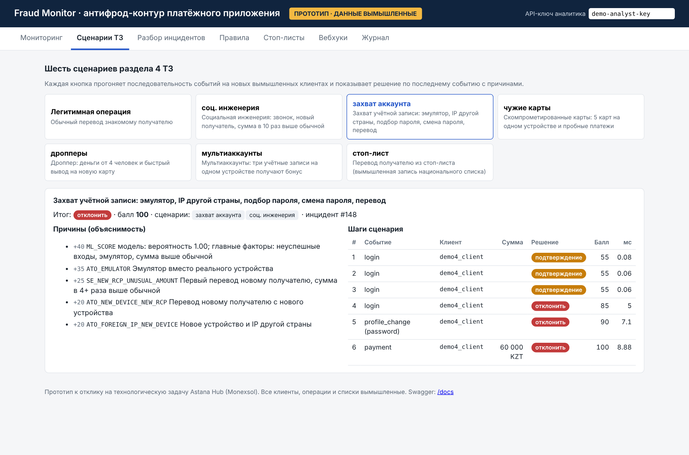

# fraud-monitor: антифрод-контур платёжного приложения (прототип)

Прототип к отклику на технологическую задачу Astana Hub **«Система мониторинга транзакций и выявления мошенничества в реальном времени для мобильного платёжного приложения»** (Monexsol Ltd.).

Сервис оценивает каждое событие до его проведения: платёж, вход, привязку карты, смену данных, получение бонуса. Ответ — **пропустить / запросить подтверждение / отклонить**, балл риска и причины. Внутри сервиса — правила аналитика по странам, ML-модель холодного старта, стоп-листы, разбор инцидентов, вебхуки и журнал.

> **Все данные вымышленные.** Поток событий генерирует `app/synthetic.py`. В него заложены шесть сценариев мошенничества из раздела 4 ТЗ с разметкой, а также легитимное поведение, похожее на мошенническое, и ошибки данных. Цифры ниже получены на этих данных и показывают, что логика работает. Это не прогноз для реального потока Monexsol.



## Соответствие ТЗ (раздел 5)

| № | Требование | Где в прототипе |
|---|---|---|
| 1 | Оценка до проведения: пропустить / подтверждение / отклонить | `POST /v1/score` → `allow` / `challenge` / `decline`, балл 0–100 |
| 2 | Правила + ML; правила меняет аналитик без разработчиков | `config/rules.yaml`, вкладка «Правила», `PUT /v1/rules` (проверка, версия, журнал, применение без перезапуска); `app/ml.py` |
| 3 | Устройство и сессия, защита от захвата аккаунта | эмулятор, root, новое устройство, неуспешные входы, смена пароля или телефона, IP другой страны, невозможное перемещение |
| 4 | Дропперы, транзит, мультиаккаунты | много отправителей у получателя, быстрый вывод входящих, бонусы с одного устройства |
| 5 | Разбор инцидентов: очередь, рабочее место, журнал | вкладка «Разбор инцидентов», `/v1/cases`, `/v1/audit` |
| 6 | Объяснимость по каждой операции | `reasons` в ответе: код, источник (правило / ML / список), баллы, текст |
| 7 | Холодный старт | преднастроенные правила и модель, обученная на синтетике; дообучение на решениях аналитиков: `POST /v1/model/retrain` |
| 8 | Стоп-листы, в том числе национальные | `/v1/lists/import`, автозагрузка из `lists/inbox`, раздельно по странам |
| 9 | Несколько стран и валют | `config/jurisdictions.yaml`: валюта, пороги, лимиты, списки и резервная политика на каждую страну |

Также реализованы: вебхуки с подписью HMAC (`/v1/webhooks`), резервная политика при сбое (`client/fallback_client.py`), роли по API-ключам, выгрузки CSV для внутреннего контроля и регулятора, OpenAPI (`/docs`, `docs/openapi.json`) и контракт данных мобильного SDK (`docs/device-signals.md`).

## Результаты на вымышленных данных

**Качество** (`python -m app.evaluate`, отчёт в `reports/evaluation.json`). Модель обучена на одном синтетическом потоке, проверка выполнена на другом. Проверочный поток: 2 500 клиентов, 14 дней, 83,6 тыс. событий.

| Показатель | Правила + ML | Только правила | Цель пилота в ТЗ |
|---|---:|---:|---:|
| Выявлено мошеннических операций (платежи и бонусы) | 90,3% | 69,5% | ≥ 80% |
| Ложные срабатывания (подтверждение или отказ у легитимных) | 0,35% | 0,10% | ≤ 0,5% |
| Ложные отказы | 0,05% | — | — |
| Легитимные операции, ушедшие на ручной разбор | 0,10% | — | ≤ 0,1% |

| Сценарий | Операций | Выявлено операций | Выявлено инцидентов |
|---|---:|---:|---:|
| Социальная инженерия | 150 | 90% | 92% |
| Захват учётной записи | 50 | 94% | 100% |
| Скомпрометированные карты | 159 | 88% | 100% |
| Дропперские схемы | 24 | 83% | 83% |
| Мультиаккаунты | 130 | 92% | 100% |
| Стоп-лист | 25 | 100% | 100% |

Синтетический фрод отделить от честных операций проще, чем реальный. На реальном потоке показатели будут ниже, пока правила и модель не откалибруют на данных пилота. Больше всего ложных срабатываний дают крупные переводы новому получателю (аренда, покупка): по ним система просит подтверждение.

**Скорость** (`scripts/loadtest.py`). Время ответа API считалось на стороне клиента, включая HTTP. Один процесс сервиса, виртуальная машина с 2 vCPU, клиент нагрузки работал на той же машине.

| Нагрузка | p50 | p95 | p99 | ≤ 200 мс | Ошибки |
|---|---:|---:|---:|---:|---:|
| 100 событий/с, 60 с | 3,2 мс | 4,8 мс | 9,4 мс | 100% | 0 |
| 250 событий/с, 60 с | 4,3 мс | 7,0 мс | 19,7 мс | 99,99% | 0 |
| 500 событий/с, 60 с, один процесс | 6,6 мс | 410 мс | 842 мс | 90,4% | 1 |

Сам движок тратит на событие 0,1–0,5 мс, остальное время уходит на HTTP-слой. Условие PoC (100 событий/с, p95 ≤ 200 мс) выполняется с большим запасом. При 500 событиях/с один процесс на 2 vCPU требование уже не выполняет: нужны несколько экземпляров за балансировщиком и общее состояние в Redis. В прототипе такая схема не собрана, см. «Что не проверено».

## Документы

- `docs/Predlozhenie_Monexsol.pdf` — предложение (8 блоков раздела 10 ТЗ)
- `docs/Primer_rezultata_Monexsol.pdf` — пример результата со скриншотами
- `docs/openapi.json`, `docs/device-signals.md` — API и контракт данных SDK

## Запуск

**Windows:** дважды щёлкнуть `run.bat`. Скрипт создаст `.venv`, установит зависимости, прогонит тесты и откроет панель http://127.0.0.1:8000.

**Вручную:**
```bash
python -m venv .venv && .venv\Scripts\activate    # Linux/macOS: source .venv/bin/activate
pip install -r requirements.txt
python -m pytest -q
python -m uvicorn app.api:app --port 8000
```

**Docker:** `docker compose up --build`

- Панель: http://127.0.0.1:8000 (демо-ключ аналитика подставлен автоматически); Swagger: http://127.0.0.1:8000/docs
- Ключи демо: `demo-integration-key`, `demo-analyst-key`, `demo-admin-key` (меняются в `.env`)
- Оценка качества: `python -m app.evaluate`; переобучение модели холодного старта: `python scripts/train_model.py`
- Нагрузка: `python scripts/loadtest.py --rps 100 --seconds 60` (для 500 событий/с: `--rps 500 --procs 4`)

Пример вызова:
```bash
curl -X POST http://127.0.0.1:8000/v1/score -H "X-API-Key: demo-integration-key" -H "Content-Type: application/json" -d "{\"event_id\":\"e1\",\"event_type\":\"payment\",\"ts\":\"2026-11-02T12:00:00\",\"jurisdiction\":\"KZ\",\"user_id\":\"u_hash_1\",\"session\":{\"device_id\":\"d1\",\"on_call\":true},\"payment\":{\"channel\":\"p2p\",\"amount\":250000,\"currency\":\"KZT\",\"recipient_id\":\"w_blk_KZ_0\"}}"
```

## Структура

```
app/
  api.py          REST API, роли, отчёты, вебхуки, демо
  engine.py       оценка: стоп-листы → правила → ML → действие → инцидент
  features.py     поведенческие признаки, устройство, связи (скользящие окна)
  rules.py        декларативные правила: проверка, ссылки на настройки страны
  ml.py           модель холодного старта, вклад признаков в решение
  lists.py        стоп-листы: импорт CSV, автообновление из папки
  webhooks.py     доставка событий с подписью HMAC и повторами
  store.py        SQLite: инциденты, журнал, списки, метки (в продакшене PostgreSQL)
  privacy.py      псевдонимизация идентификаторов, маскирование карт
  synthetic.py    генератор вымышленного потока со сценариями и «шумом»
  evaluate.py     прогон потока и расчёт показателей
  demo.py         шесть сценариев ТЗ для панели
client/fallback_client.py   клиент заказчика с резервной политикой
config/           правила и настройки стран
lists/            пример стоп-листа (вымышленный, 2 строки с ошибками для проверки импорта)
models/model.json модель холодного старта
reports/          результаты оценки и нагрузочных тестов
docs/             скриншоты, OpenAPI, контракт данных SDK, PDF
tests/            автотесты (26)
```

## Что не проверено

- Данные Monexsol и реальный поток не использовались. Все пороги и веса стартовые, их калибруют в пилоте.
- Мобильный SDK не разработан, есть только контракт данных (`docs/device-signals.md`).
- Интеграция с тестовой средой заказчика и с национальными антифрод-системами: формат списков взят условный.
- Горизонтальное масштабирование до 500 событий/с: состояние хранится в памяти одного процесса. Для нескольких экземпляров его нужно перенести в Redis.
- Доступность 99,9%, шифрование хранилища, TLS, сертификации PCI DSS и ISO 27001 относятся к уровню инфраструктуры и в прототипе не проверялись.
- Сборка Docker-образа в среде разработки не запускалась (Dockerfile стандартный).
- Проверка по санкционным спискам и спискам ПДЛ (опциональный модуль) не реализована.

## Лицензия

Все права защищены, см. [LICENSE](LICENSE).
